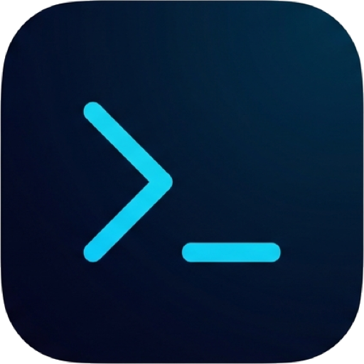
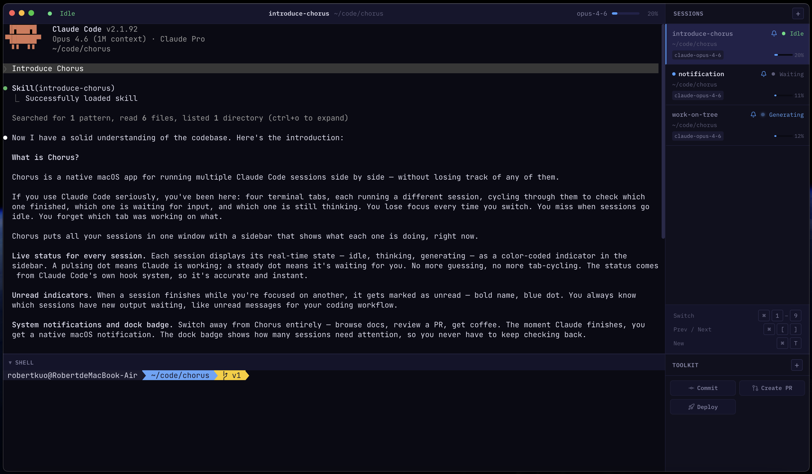

<h1 align="center">
  
  Chorus
</h1>

  Multi-session Claude Code terminal manager

  
  
  

  

---

**Which window was fixing that bug again?** If you run more than one Claude Code session at a time, you know the drill: `Cmd+Tab` between terminal windows, try to remember which one is writing tests vs. refactoring, check if that long-running session is still thinking or waiting for input. It's busywork that pulls you out of flow.

Chorus puts all your sessions in one window — with live status, unread indicators, and notifications, so you never lose track.

## Download

Grab the latest build from the [GitHub Releases](https://github.com/a179346/chorus/releases) page.

## Features

### Live session status

Each session shows a color-coded indicator — idle, thinking, generating, needs input — updated in real time via Claude Code's hook system. A session blocked on a permission prompt stands out from one that's simply done. Scan the sidebar and immediately see which sessions are working, which are done, and which need you.

### Unread indicators

When a session finishes while you're focused on another one, it gets marked as unread. Press `⌘J` — or click the **N need you** pill above the session list — to jump to the next session that's unread or waiting on you.

### Keyboard first

Press `⌘K` for the command palette: type a few letters to jump to any session, or run an action — rename, pull requests, notifications, toolkit commands — without reaching for the mouse. Hold `⌘` to see each session's `⌘1`–`⌘9` shortcut right in the sidebar.

### System notifications

Switch away from Chorus entirely — read docs, review a PR, grab coffee — and get a native macOS notification the moment a session goes idle or asks for permission (with Claude's own description of what it needs). Click the notification to jump straight to that session; it clears itself once you've looked at that session. A dock badge counts the sessions with output you haven't seen yet.

### Restart and reopen

If Claude Code exits, restart it in place — the conversation resumes. Closed a session by accident? `⌘⇧T` reopens it, and **File → Recently Closed** lists the last ten.

### Start with a task

Give a new session its first prompt and it gets to work right away — turn on notifications and come back when it's done. Any other Claude Code flag (`--model`, `--allowed-tools`, …) goes in the same dialog, and the last ones you used are remembered.

### Toolkit command panel

Save frequent commands (e.g. `/commit`, `git status`) and execute them with one click.

### Session persistence

Sessions and layout survive app restarts. Pick up right where you left off.

---

One window. Every session. Nothing missed.
